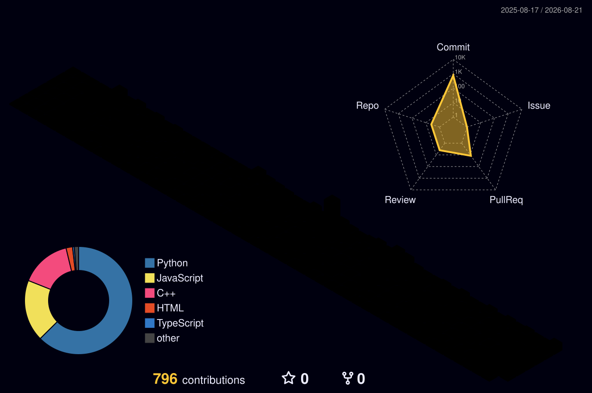

<a href="./README.md">简体中文</a> | <b>English</b>

  

  
  
  

 

## 🚀 About Me

- 🎓 A junior college student
- 🔭 **Main focus**: `Python` `C++ (Embedded)`
- 🌱 **Currently learning**: `MySQL` `JAVA`
- 💡 **Career goal**: Embedded Systems Engineer / Backend Developer
- 📫 **Contact me**: `2185823427@qq.com`
- ⚡ **Interests**: `Minecraft` `CODE` `Touhou Project`

## 🏛️ Fairy Oracle Sanctuary (My Organization)

I'm a member of **Fairy Oracle Sanctuary** — a developer collective with the spirit of free software at its core and open-source collaboration as its method, and also a Touhou Project fan circle.

> 🖋️ *"Connect the World with Goodwill."*

| | |
|---|---|
| 🔗 **GitHub Org** | [github.com/Fairy-Oracle-Sanctuary](https://github.com/Fairy-Oracle-Sanctuary) |
| 🌐 **Official Website** | [fairy.ora-san.org](https://fairy.ora-san.org/) |
| 📜 **Our Manifesto** | [docs.ora-san.org](https://docs.ora-san.org/) |
| 💬 **Discord Community** | [discord.gg/TfuNYPsjmQ](https://discord.gg/TfuNYPsjmQ) |
| 📺 **Bilibili** | [space.bilibili.com/499929312](https://space.bilibili.com/499929312) |
| 💖 **Sponsor Us (Afdian)** | [ifdian.net/a/Fairy_ora_san](https://ifdian.net/a/Fairy_ora_san) |

## 🛠️ Tech Stack

  

## 📊 Fairy Oracle Sanctuary Team Stats

  
  
  

**Organization tech stack**:

**Popular projects**:

## 📅 Contribution Activity

### 🐍 Snake Animation

<picture>
  <source media="(prefers-color-scheme: dark)" srcset="https://raw.githubusercontent.com/baby2077/baby2077/output/github-contribution-grid-snake-dark.svg">
  <source media="(prefers-color-scheme: light)" srcset="https://raw.githubusercontent.com/baby2077/baby2077/output/github-contribution-grid-snake.svg">
  
</picture>

### 🏔️ 3D Contribution Graph

  

---

  ⭐ If you like our open-source projects, consider starring <a href="https://github.com/Fairy-Oracle-Sanctuary">Fairy Oracle Sanctuary</a>, or supporting us on <a href="https://ifdian.net/a/Fairy_ora_san">Afdian</a>!

